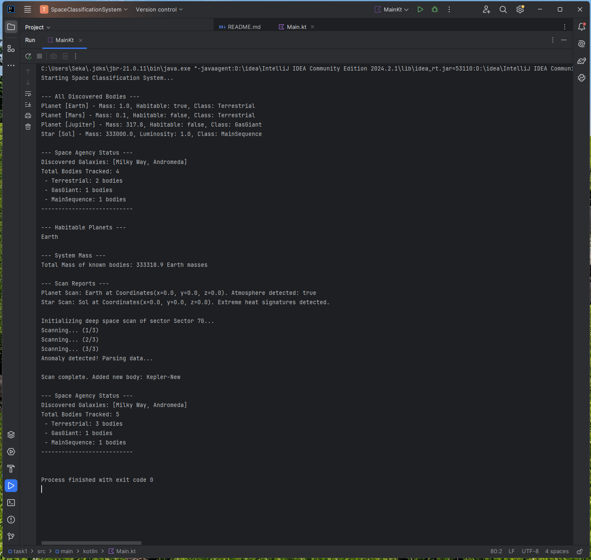

# Space Classification System

A Kotlin console application that models a space agency managing and tracking celestial bodies (planets and stars). This project is designed to demonstrate core Kotlin features.

## How to run the project

This project is built using Gradle. To run it, you can use IntelliJ IDEA or the command line.

### Using Command Line (Gradle)
1. Since we didn't include the gradle wrapper in this repository, you should use IntelliJ IDEA or install gradle on your machine.
2. If using gradle command line: `gradle run`

### Using IntelliJ IDEA
1. Open the project folder in IntelliJ IDEA.
2. Wait for Gradle to sync.
3. Open `src/main/kotlin/Main.kt`.
4. Click the green play button next to the `main` function.

## Demonstrated Requirements

Here is where the main homework requirements are demonstrated in the code:

- **Variables, data types, conditions, and loops:** Demonstrated in `Main.kt` and `SpaceAgency.kt` (e.g., `for` loop in `processBodies`, map iteration in `displayAgencyStatus`).
- **List, Set, and Map:** Managed inside the `SpaceAgency` singleton (`celestialBodies`, `discoveredGalaxies`, `bodiesByClass`).
- **Collection operations (map, filter, reduce):** Demonstrated in `SpaceAgency.kt` (`getHabitablePlanets` uses `filter`, `calculateTotalMass` uses `map` and `reduce`).
- **Functions, higher-order functions, and lambdas:** Demonstrated with `SpaceAgency.processBodies` which takes a lambda `(CelestialBody) -> Unit`.
- **Classes and objects:** Data is structured with classes (`Planet`, `Star`), and `SpaceAgency` is a Singleton `object`.
- **Inheritance:** `Planet` and `Star` inherit from the abstract base class `CelestialBody`.
- **Interfaces and polymorphism:** `CelestialBody` implements the `Scannable` interface. Polymorphism is shown when iterating over `CelestialBody` objects and calling their overridden `displayDetails()` method.
- **Data class:** `Coordinates` is a data class holding x, y, and z values.
- **Sealed class:** `BodyClassification` is a sealed class restricting the possible types of celestial bodies.
- **Suspend function and coroutine:** A `suspend fun deepSpaceScan` simulates a time-delayed operation using `delay()`, executed within a `runBlocking` coroutine builder in `main()`.

Run project:

